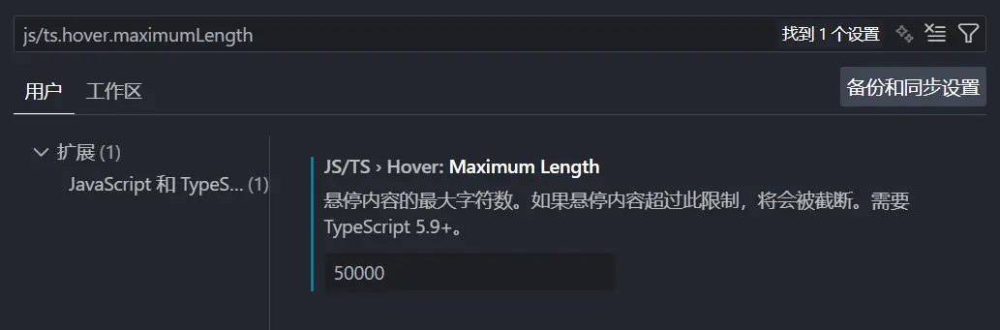

Recently I ran into some huge TypeScript types in a project and wanted to inspect their actual structure, but VSCode only shows a small part by default and replaces the rest with an ellipsis `...`:


That annoyed me to no end. VSCode can't expand the type because that's just what the language server returns.

After some Googling, I found a [solution](https://segmentfault.com/a/1190000043495782).

However, that March 2023 article is outdated, and the workaround is quite hacky (it directly modifies the workspace's TS server script). It did point to the [corresponding issue](https://github.com/microsoft/vscode/issues/64566), though.

~~It's been almost 8 years and this issue is still open.~~

Unfortunately, the issue didn't solve my problem. I took another look at the file behind that hardcoded workaround (the [file change](https://github.com/microsoft/vscode/issues/64566#issuecomment-2376295786) was linked in the issue comments), and from `defaultHoverMaximumTruncationLength` I found another variable, `maximumLength`, which takes precedence over the former. Ctrl+click to view its definition led me to the `getQuickInfoAtPosition` function, and from there to the key part:

```js title=node_modules/typescript/lib/tsserver.js "userPreferences.maximumHoverLength"
const quickInfo = project.getLanguageService().getQuickInfoAtPosition(
	file,
	this.getPosition(args, scriptInfo),
	userPreferences.maximumHoverLength,
	args.verbosityLevel,
);
```

This `userPreferences.maximumHoverLength` clearly looked like a setting that should exist in VSCode, so I went back to GitHub and found [#248181](https://github.com/microsoft/vscode/pull/248181), a PR merged just this May. Finally!

From the PR diff I got `js/ts.hover.maximumLength`. Increasing it solves the problem perfectly. Nice.

:::note[Laughing at myself]
Rereading this on 2026-06-29: I went in such a long circle I laughed at myself.
:::


