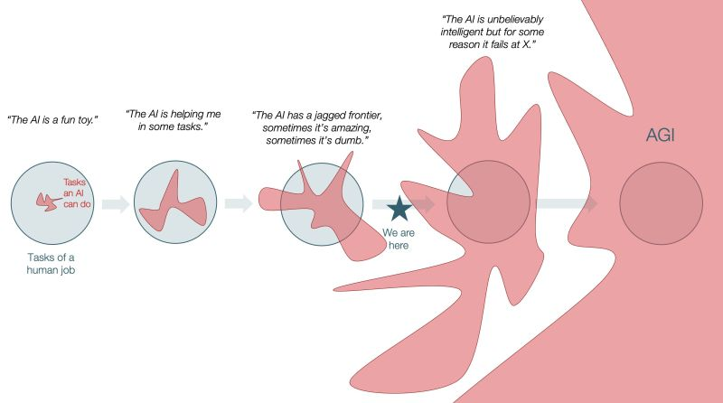

当前主流 LLM 模型是基于 Transformer 的 Next Token Prediction 机器，通过预训练大量语料库注入世界知识，再使用 SFT 调整输出为对话风格，最后通过 RLHF、RLVR 等后训练方法对齐人类喜好、控制安全风险、提升 Tool Call 正确性、增强泛化能力和 `长程代理化编码能力`。

我曾在不同场合，时间和地点多次对 AI / LLM / Agent 的智力水平发表过不满的言论，智能（或智力）是一个宽泛的词汇，Wikipedia 对智力的定义如下：

>智力（英语：intelligence）是指生物一般性的精神能力。这个能力包括以下几点：推理、理解、计划、解决问题、抽象化、表达意念以及语言和学习的能力。尽管智力的定义与重要性存在争论，特别是在主流刊物中，研究者们还是能够在不少与智力相关的问题上持有共识。

人们将大部分的可或不可量化的评估标准归纳于这一个概念下，而当我们从不同的智能维度观察人工智能，就发现其虽然在某些方面远胜于人类，如知识库大小、思考速度、模仿能力、可快速自我复制、Astra 远超人类专家的多模态精确理解能力等，却在部分方面不及预期，从现在还能被拿出来拷打"无幻觉模型" Jev 的 [strawberry 有几个 r 的问题](https://www.jevradar.com/projects/can-typesafeai-jev-count-the-r-s-in-strawberry)、9.8 vs 9.11以及洗车店难题，到常识性幻觉、无法及时更新的知识库截止日期、难以对齐人类偏好和破甲问题等。此即所谓的 `Jagged Intelligence` 

人工智能在不同智能度量上与人类的严重偏离，是其与人类完全不同的训练方式和内部结构决定的，即所谓的 [Alien Mind](https://openai.com/zh-Hans-CN/index/an-alien-mind/) 。

# 生而为人

通过网络信息查阅，人类大脑具有约 $8.6\times10^{10}$ 个神经元，神经元之间又具有约 $10^{14}$ 到 $10^{15}$ 数量的突触连接。有研究指出，考虑到蛋白质构象的复杂性，一个突触可存储约 4.7 比特的信息。若以此计算，整个人脑的存储容量可达约 $9.1\times10^{14}$ 字节（910 TB）。

当前的前沿人工智能模型，以 Astra 为例，有约10万亿，即 $1.0×10^{13}$ 大小的参数。

在进化过程中，人类逐渐形成了高度专门化的认知结构，这些结构塑造了我们独特的智能形态。

# 长期记忆与在线学习

人类最显著的优势之一是强大的**长期记忆**和**少样本学习**能力。一个婴儿只需要看到几次”猫”就能建立起对猫的概念，并在未来持续识别各种品种的猫。这种能力依赖于人脑的在线学习机制——我们不需要重新训练整个神经网络，而是通过海马体和新皮质之间的协作，将短期经验快速整合到长期记忆中。

更重要的是，人类记忆具有**相近性**和**连接性**。当我们想起一件事时，相关的记忆会被自动激活——闻到某种香味可能唤起童年的回忆，看到数学公式可能联想到物理应用。这种记忆的网状结构让我们能够**活用**知识，在新情境中灵活调用并更新过去的经验。这也是 LLM 所需要的**泛化**能力。

相比之下，当前的 LLM 缺乏真正的长期记忆机制。虽然 RAG（检索增强生成）和长上下文技术提供了某种”记忆”，但这更像是查阅外部笔记，而非内化的知识。模型无法真正”记住”与你的对话，无法在对话之外持续学习和成长。

# 层次化抽象与工作记忆

人类擅长构建**层次化的抽象**。我们可以在不同的抽象层次上思考同一个问题——从具体的代码实现，到设计模式，再到架构原则，最后到哲学层面的权衡。这种能力让我们能够自然而然地对对象构建起全面的理解，并可以自由地移动注意力在不同的抽象层级进行思考。人类大脑自动地在学习过程中通过抽象提取将视觉信息提取为字符、单词、句子、篇章的层级结构，因而能够自然地调动注意力下降到字符级的抽象来处理 strawberry 有几个 r 的问题。

然而，人类的**工作记忆**是有限的——心理学家 George Miller 的经典研究指出，人类只能同时在工作记忆中保持 7±2 个”组块”（chunks）。这个限制反而成为了人类进行抽象认知活动的动机：它迫使我们进行抽象、压缩、模块化，创造出层次化的知识结构。

# 主体性、世界模型与具身认知

人类拥有**主体性**——我们是独立的行动者，具有自我意识、意图和目标。这种主体性植根于我们对世界的内在**世界模型**。从婴儿期开始，我们就通过与物理世界的互动构建对因果关系、物理规律、社会规则的理解。这个世界模型是**具身的**（embodied）——我们通过身体感知和行动来理解世界。

我个人认为 RSI 中最重要的是 Self ，即根据主体自身的需要对自身性能进行改进的能力，这需要极强的元认知 / 自省能力或者说自我意识。当前的 AI 模型对齐依赖于人类手动注入的价值观和意图，模型很少能够意识到自身的状态，并产生自主化的、负责任的且具有主体性的行动。

LLM 缺乏具身经验。它们从未触摸过物体、感受过重力、经历过时间的流逝。虽然多模态模型可以处理视觉和听觉输入，但这仍然是符号层面的处理，而非真正的感知体验。这导致 LLM 在常识推理、物理直觉、社会互动等方面表现不稳定。

# Token、思维载体与抽象边界

人类思维不是纯粹的语言性的。我们的思考涉及视觉意象、空间关系、运动感觉、情感体验——这些都是**高维的**、**连续的**表示。当我们将思想转化为语言时，必然发生**有损压缩**（lossy compression）。很多微妙的感觉、直觉、顿悟难以用语言精确表达——这就是所谓的”只可意会，不可言传”。

语言学中，索绪尔区分了**能指**（signifier，符号的形式）和**所指**（signified，符号的意义）。对于人类，语言是指向更丰富内在表示的**指针**；但对于 LLM，token 本身就是其思维的全部。模型没有 token 之外的”内在体验”，它的世界就是 token 序列。

这种差异导致了根本性的**思想边界**。有些人类能够理解的概念，可能无法在 token 空间中充分表示，而 token 所表现出的可被学习的统计分布可能遗漏重要的作者经验和意图；反之，LLM 在高维向量空间中发现的某些模式，可能也超出了人类语言的表达能力。

# 假设-试验-验证闭环

人类学习的一个机制是**假设-试验-验证闭环**。我们提出假设，在现实世界中试验，根据反馈调整理解。这个过程是主动的、交互的、渐进的。一个孩子学习”热”的概念，不仅仅是通过语言描述，更是通过触摸热水、感受疼痛、建立因果联系。

当前的 LLM 训练是离线的、批量的。模型在静态数据集上训练，无法与真实世界进行实时交互和验证。虽然 RLHF 引入了人类反馈，但这仍然是延迟的、间接的。模型无法像人类那样通过实时试错来快速调整行为。

Agent 系统试图弥补这一差距，通过让 LLM 与工具和环境交互来形成闭环。但这仍然受限于 token 序列的本质——每次交互都需要完整的推理周期，无法实现人类那种快速、自动的反射性调整。

[Theory is all you need](https://papers.ssrn.com/sol3/papers.cfm?abstract_id=4737265)

# 并行 IO 与思维

人类大脑是一个高度并行的系统。我们可以同时：
- 有意识地思考一个问题
- 潜意识地处理感知信息
- 自动执行熟练的运动任务
- 在后台整合记忆和情感

这种**异步 IO** 能力让人类能够高效地处理复杂的多任务场景。当你开车时，你的运动系统自动处理转向和刹车，感知系统持续监控路况，而高层认知系统可以进行对话或思考其他问题。

LLM 的推理是完全同步的、序列化的。每个 token 的生成都依赖于前一个 token，没有真正的”后台思考”或”孵化期”。虽然思维链（Chain of Thought）或循环 Transformer 引入了某种”推理步骤”，但这仍然是显式的、线性的过程，缺乏人类思维的多层次并行性。其输入和输出永远是半双工进行的。

人类智能中最神秘的现象之一是**顿悟**（'Aha' Moment）——在长时间思考一个问题后，答案突然在意想不到的时刻涌现。这种现象揭示了人类思维的**异步**和**潜意识**特性。

当我们”睡眠中想到答案”或”洗澡时灵感乍现”时，实际上是大脑在后台持续处理问题。这种分布式、异步的认知处理让人类能够在不同的思维层次上并行工作——有意识地专注于一个任务，同时潜意识地整合信息、寻找模式、重组概念。

#
想到啥写啥，写得很碎。